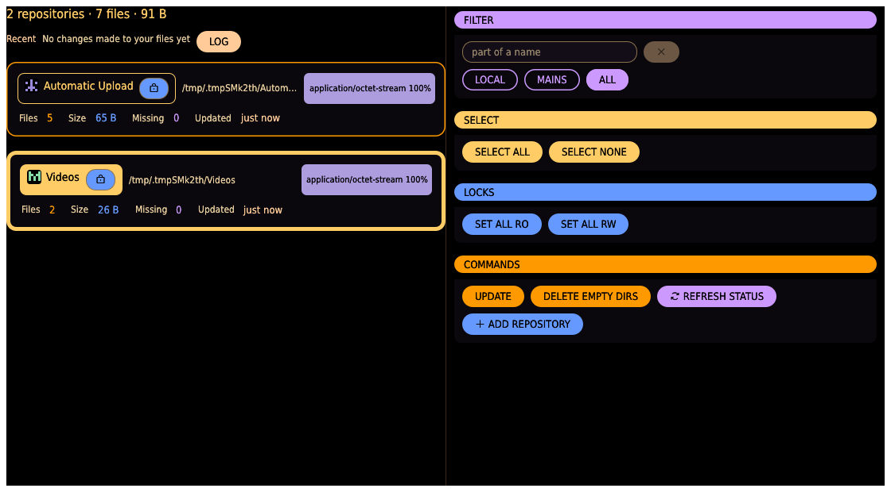
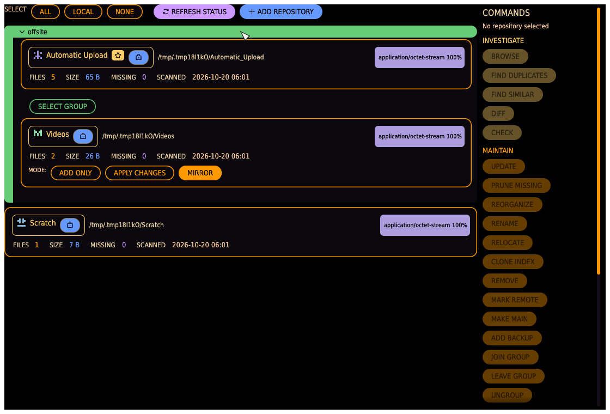

# Repository page

The app opens on the repository page: your repositories as **cards** on the left, and on
the right, behind a separator you can drag, four frames — **FILTER**, **SELECT**, **LOCKS**
and **COMMANDS**. A repository is a name linked to a folder on disk, tracked by its own
index — the GUI equivalent of the [`repo` subcommand](../cli.md#repo). **REPOSITORIES** in
the [navigation bar](index.md#top-bar) brings you back here from any other page.

This page looks after the repositories themselves: registering, scanning, locking and
grouping them. Finding duplicates, syncing, copying and deleting happen on their own pages,
and each of those chooses its own repositories; nothing selected here carries over.

## Totals and recent changes

Above the cards one line sums everything the app looks after: how many repositories,
files and bytes. Under it, **RECENT** lists the newest changes the app made to your files —
each a chip reading the action and the file name, red when it failed, with the time,
repository and whole path on hover — and a **LOG** button that opens the full
[event log](index.md#the-activity-window). Until the app has changed anything it says so.

## Filter

The **FILTER** frame decides which repositories the rest of the page can touch:

- A **text field** — only repositories whose name contains the text stay usable; the **x**
  beside it clears it.
- **LOCAL** / **MAINS** / **ALL** — one at a time. **LOCAL** leaves out every repository
  you **marked remote** (see below): the quick everyday choice that leaves slow network or
  cloud mounts alone. **MAINS** keeps only the main repository of each backup group.
  **ALL** leaves nothing out.

A repository that does not match is never hidden: its card is greyed out and sorted to the
bottom. A greyed-out repository cannot be selected, its card's menu is not available, and
nothing on this page touches it — not the commands, not SELECT ALL, not SET ALL RO / RW. A
selected repository that becomes greyed out drops out of the selection.

## Selection

Click a card's name chip to select or deselect the repository; a selected card gets a
thick, bright amber border all round. The **SELECT** frame changes the whole selection at
once:

- **SELECT ALL** — select every repository that is not greyed out.
- **SELECT NONE** — clear the selection.

The selection exists only on this page, and only UPDATE and DELETE EMPTY DIRS use it.

## Locks

The **LOCKS** frame sets the [session lock](index.md#repository-locks) of many repositories
at once:

- **SET ALL RO** — lock every repository that is not greyed out.
- **SET ALL RW** — unlock every repository that is not greyed out.

The padlock on each card still locks or unlocks that one repository.

## Commands

The **COMMANDS** frame:

- **UPDATE** — scan the selected repositories.
- **DELETE EMPTY DIRS** — delete the empty folders of the selected repositories.
- **REFRESH STATUS** — re-check every repository's location and reachability, so a
  reconnected drive turns reachable again. No files are read, and it runs at once. This is
  what produces the LOCAL / REMOTE / OFFLINE / MISSING pills on each card.
- **ADD REPOSITORY** — opens the dialog that registers a new folder (see below). Folders
  dropped anywhere onto the window are registered too.

UPDATE and DELETE EMPTY DIRS never change anything straight away. Each first looks at the
selected repositories in the [activity window](index.md#the-activity-window) — with its
progress and CANCEL — and then shows what it would do:

- **UPDATE — WHAT WOULD CHANGE** lists each repository with its count of new, changed,
  missing and unchanged files, or why it cannot be checked (an offline drive, say). This
  look also sets the UP TO DATE / UPDATE REQUIRED pill on each card.
- **DELETE EMPTY DIRS — WHAT WOULD GO** lists each repository's empty folders. A locked
  repository is skipped, with a note to unlock it first.

Only **OK** changes anything; it is greyed when there is nothing to do. **CANCEL** closes
the window and leaves everything as it was. After OK the work runs in the activity window,
every repository on its own row with its progress, and ends on one report. UPDATE scans the
repositories that could be checked; DELETE EMPTY DIRS deletes exactly the folders it listed,
each only if it is still empty — a folder that gained a file meanwhile stays, and the report
says so. How many folders each repository lost is written to the event log.

A scan in the activity window shows the file being hashed, a bar with percent and count,
elapsed time and an estimate of what is left, and every problem as it occurs; **CANCEL**
stops it, and whatever was already hashed stays committed to the index. When it ends the
card's finished-scan line states the hash work explicitly — "hashed N file(s), X MB" — so a
slow scan explains itself: `hashed 0` means the time went to walking the folder (a slow
mount), not to hashing. Only one operation runs at a time: an UPDATE while something else
is up is refused with a card naming what is still running.

A scan that finds **no files at all** in a folder whose index holds files is not carried
out: an unmounted drive looks exactly like this, and an emptied main would turn the next
MIRROR push into a wipe. The app asks instead — **SCAN FOUND NO FILES** — and nothing has
been changed yet. **SCAN ANYWAY** marks every indexed file missing, because the repository
really is empty now; **CANCEL** leaves the index as it is.

## The card menu

Right-click a card — or its name — for the repository's own edits:

- **RENAME**, **RELOCATE**, **CLONE INDEX** and **REMOVE** open their editor on the card.
- **MARK REMOTE** / **UNMARK REMOTE** flips the remote flag on the spot.

It also holds the repository's place in a backup group (see [Backup groups](#backup-groups)):

- **MAKE MAIN** and one **JOIN GROUP** entry per existing group, on a repository that is in
  no group.
- **LEAVE GROUP**, on a backup.

Each answers with a notification card. None of them changes files on disk, so none writes
an event-log line.

## Repository cards

Each card shows the repository's name chip (with its identicon, the **★ MAIN** badge on a
group's main, and its padlock), its on-disk path, status pills, a MIME-type breakdown (top
few types by share, pinned top-right), and stats:

| Stat    | Meaning                                                                                                                                            |
| ------- | -------------------------------------------------------------------------------------------------------------------------------------------------- |
| FILES   | Indexed files (files that vanished from disk since the last scan are excluded).                                                                    |
| SIZE    | Total on-disk size of indexed files.                                                                                                               |
| MISSING | Files indexed before but no longer found on disk — kept as history, excluded from stats and duplicate search until a rescan confirms they're back. |
| UPDATED | How long ago this repository was last scanned — "just now", "3 hours ago", "9 days ago", or "never" — with the exact date and time on hover.      |

Status pills:

- **LOCAL** / **REMOTE** — the folder is on this machine, or on a reachable network mount.
- **OFFLINE** — a network mount that isn't reachable right now; scans will fail until it's
  back.
- **MISSING** — the local folder no longer exists or can't be read; RELOCATE it or restore
  the folder before scanning.
- **NEVER SCANNED** — the repository has no index yet: select it and run UPDATE before
  anything in it can be found, compared or moved.
- **UP TO DATE** / **UPDATE REQUIRED** — from UPDATE's last look: whether there are new,
  changed, or missing files since the last scan.
- **MARKED REMOTE** — your own judgement that this repository's folder lives on a slow
  mount (NFS, cloud); the LOCAL filter greys it out. Deliberately never auto-detected — an
  NFS mount can look local to a probe — and distinct from the LOCAL/REMOTE status pill.

The padlock is the repository's [session lock](index.md#repository-locks): closed means
nothing in the app deletes or overwrites its files.

## Backup groups

A **backup group** links one **main** repository to one or more **backup** repositories
(sinks). Groups are built from the card menus; pushing one is the **SYNC** page's job:

- **MAKE MAIN** (a repository in no group) — turn it into the main of a new group.
- **JOIN GROUP *name*** (a repository in no group) — add it to that group as a backup.
- **LEAVE GROUP** (a backup) — take it back out of its group.
- Right-click the group frame's bar for **ADD BACKUP** — add a *new* backup that starts as
  a clone of the main's index, pointed at a folder you choose; the editor opens in the
  frame — and **UNGROUP**, which disbands the group; every repository stays, just unlinked.
- A group is framed together, titled with the group name: the main's card first, then every
  backup's card, so a group reads as a single block and an ungrouped repository as a bare
  card. A group never folds, so whether its members are selected is always in sight.
- The main carries a **★ MAIN** badge. The same badge appears on the repo chip wherever the
  repository is named, so an original is never mistaken for a backup.
- Each backup's card carries its own **mode** chips — `ADD ONLY` copies what that backup
  lacks; `APPLY CHANGES` also carries the main's own deletions over; `MIRROR` deletes from
  it everything the main does not have (click to flip). A group can mirror some backups and
  only-add to others.

## Add Repository dialog

- **FOLDER** — type a path, or **CHOOSE…** to open a native folder picker.
- **NAME** — the repository's display name; leave blank to default to the folder's own
  name. Must be unique among registered repositories (a clash is flagged in red before you
  can submit).
- **ADD** registers the repository (it is not scanned automatically — select it and run
  UPDATE afterwards); **CANCEL** closes without registering anything.
