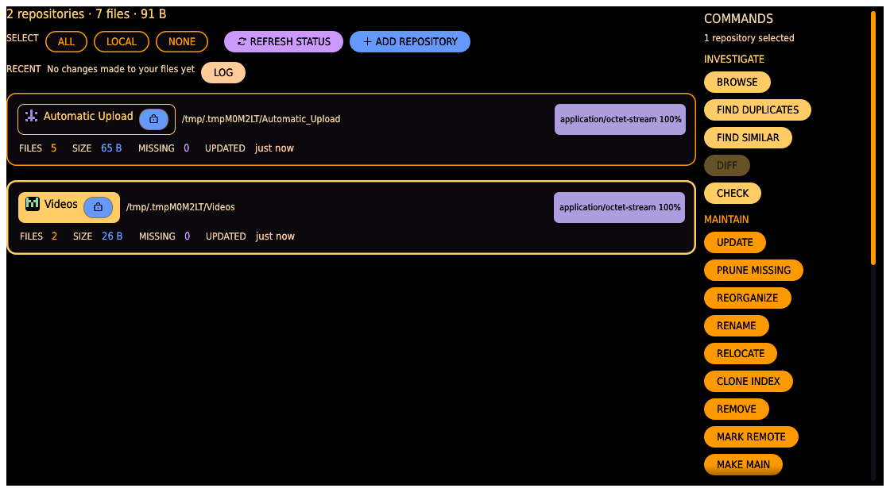
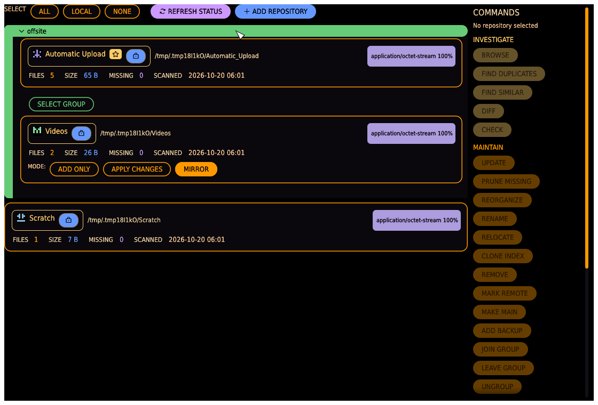

# Start page

The app opens on the start page, and every piece of work starts here: your repositories as
**cards** on the left, the **commands** on the right. A repository is a name linked to a
folder on disk, tracked by its own index — the GUI equivalent of the [`repo`
subcommand](../cli.md#repo).

## Totals and recent changes

Above the cards one line sums everything the app looks after: how many repositories,
files and bytes. Below the selection row, **RECENT** lists the newest changes the app made
to your files — each a chip reading the action and the file name, red when it failed,
with the time, repository and whole path on hover — and a **LOG** button that opens the
full [event log](index.md#the-activity-window). Until the app has changed anything it says
so.

## Selection

Click a card's name chip to select or deselect the repository; a selected card is outlined
in amber. The row above the cards changes the whole selection at once:

- **ALL** — select every repository (then UPDATE or CHECK scans them all as one operation).
- **LOCAL** — select every repository except the ones **marked remote** (see below): the
  quick everyday selection that leaves slow network or cloud mounts alone.
- **NONE** — clear the selection.
- **REFRESH STATUS** — re-check every repository's location and reachability, so a
  reconnected drive turns reachable again. No files are read. This is what produces the
  LOCAL / REMOTE / OFFLINE / MISSING pills on each card.
- **ADD REPOSITORY** — opens the dialog that registers a new folder (see below). Folders
  dropped anywhere onto the window are registered too.

## Commands

The list beside the cards is always complete and always in the same order, grouped by what
you want to do. A command the current selection does not allow is greyed, and hovering it
says why — *needs exactly one repository*, *needs exactly two*, *needs a backup group*, or
*'X' is locked*.

| Group           | Commands                                                                                                                                                                                                              |
| --------------- | --------------------------------------------------------------------------------------------------------------------------------------------------------------------------------------------------------------------- |
| **INVESTIGATE** | **BROWSE** (one repository), **FIND DUPLICATES** / **FIND SIMILAR** (one or more), **DIFF** (two), **CHECK** (any — a dry run that reports what an UPDATE would do).                                                   |
| **MAINTAIN**    | **UPDATE** (any), **PRUNE MISSING**, **REORGANIZE**, **RENAME**, **RELOCATE**, **CLONE INDEX**, **REMOVE**, **MARK REMOTE** (one), and the group commands **MAKE MAIN**, **ADD BACKUP**, **JOIN GROUP**, **LEAVE GROUP**, **UNGROUP**. |
| **MOVE**        | **COPY** / **MOVE** (one repository into a folder, or two), **SYNC** / **MIRROR** (two), **GROUP SYNC** / **GROUP SYNC BACK** (a backup group).                                                                        |
| **CLEAN**       | **DEDUPE AGAINST** (two or more), **PURGE BY FILTER**, **EMPTY DIRECTORIES** (one, unlocked).                                                                                                                       |

What happens when you click one:

- **UPDATE** and **CHECK** run at once in the [activity window](index.md#the-activity-window),
  every selected repository on its own row with its progress, and end on one report.
  Already up-to-date repositories finish almost instantly.
- **RENAME**, **RELOCATE**, **CLONE INDEX**, **REMOVE** and **ADD BACKUP** open their editor
  on the card; **MARK REMOTE** and the other group commands apply on the spot. Each answers
  with a notification card. None of them changes files on disk, so none writes an
  event-log line.
- Every other command opens its own body under a **header strip** that names the selected
  repositories and the command. The body is the [Duplicates](duplicates.md),
  [Transfer](transfer.md), [Grooming](grooming.md) or [Browse](browse.md) view with the
  repositories already filled in from the selection, and the sections the start page
  answered folded shut. The **START** bar on the strip returns to the start page with the
  selection kept.

A backup group gives the directed commands their direction for free: select the group and
GROUP SYNC pushes its main to the selected backups. Any other pair of repositories picks its
source and target inside the body's WITH WHICH section — selection order never decides.

## Repository cards

Each card shows the repository's name chip (with its identicon, the **★ MAIN** badge on a
group's main, and its padlock), its on-disk path, status pills, a MIME-type breakdown (top
few types by share, pinned top-right), and stats:

| Stat    | Meaning                                                                                                                                            |
| ------- | -------------------------------------------------------------------------------------------------------------------------------------------------- |
| FILES   | Indexed files (files that vanished from disk since the last scan are excluded).                                                                    |
| SIZE    | Total on-disk size of indexed files.                                                                                                               |
| MISSING | Files indexed before but no longer found on disk — kept as history, excluded from stats and duplicate search until a rescan confirms they're back. |
| UPDATED | How long ago this repository was last scanned — "just now", "3 hours ago", "9 days ago", or "never" — with the exact date and time on hover.      |

Status pills:

- **LOCAL** / **REMOTE** — the folder is on this machine, or on a reachable network mount.
- **OFFLINE** — a network mount that isn't reachable right now; scans and checks will fail
  until it's back.
- **MISSING** — the local folder no longer exists or can't be read; RELOCATE it or restore
  the folder before scanning.
- **NEVER SCANNED** — the repository has no index yet: select it and run UPDATE before
  anything in it can be found, compared or moved.
- **UP TO DATE** / **UPDATE REQUIRED** — from the last CHECK: whether there are new,
  changed, or missing files since the last scan.
- **MARKED REMOTE** — your own judgement that this repository's folder lives on a slow
  mount (NFS, cloud); the LOCAL selection skips it. Deliberately never auto-detected — an
  NFS mount can look local to a probe — and distinct from the LOCAL/REMOTE status pill.

The padlock is the repository's [session lock](index.md#repository-locks): closed means
nothing in the app deletes or overwrites its files, and the commands that would are greyed
with that reason.

A scan or check runs in the activity window, which blocks the rest of the app while it
works: it shows the file being hashed, a bar with percent and count, elapsed time and an
estimate of what is left, and every problem as it occurs; **CANCEL** stops it, and whatever
was already hashed stays committed to the index. When it ends the window shows the result,
and the card's finished-scan line states the hash work explicitly — "hashed N file(s), X
MB" — so a slow scan explains itself: `hashed 0` means the time went to walking the folder
(a slow mount), not to hashing. Only one operation runs at a time: an UPDATE while
something else is up is refused with a card naming what is still running.

## Backup groups

A **backup group** links one **main** repository to one or more **backup** repositories
(sinks). Groups are managed from the command list; pushing one is **GROUP SYNC**:

- **MAKE MAIN** (one ungrouped repository selected) — turn it into the main of a new group.
- **ADD BACKUP** (a main selected) — add a *new* backup that starts as a clone of the main's
  index, pointed at a folder you choose; the editor opens on the card.
- **JOIN GROUP** (a main and one ungrouped repository selected) — add the ungrouped one to
  the main's group as a backup.
- **LEAVE GROUP** (a backup selected) — take it back out of its group.
- **UNGROUP** (a main selected) — disband the group; every repository stays, just unlinked.
- A group is framed by its own section, titled with the group name: the main's card and
  every backup's card sit inside one rail, so a group reads as a single block and an
  ungrouped repository as a bare card. Groups start **folded** — the list stays about your
  originals — and clicking the section header opens one. **SELECT GROUP** inside the frame
  selects the main and every backup at once, which is what enables GROUP SYNC.
- The main carries a **★ MAIN** badge. The same badge appears on the repo chip wherever the
  repository is named, so an original is never mistaken for a backup.
- Each backup's card carries its own **mode** chips — `ADD ONLY` copies what that backup
  lacks; `APPLY CHANGES` also carries the main's own deletions over; `MIRROR` deletes from
  it everything the main does not have (click to flip). A group can mirror some backups and
  only-add to others.

## Add Repository dialog

- **FOLDER** — type a path, or **CHOOSE…** to open a native folder picker.
- **NAME** — the repository's display name; leave blank to default to the folder's own
  name. Must be unique among registered repositories (a clash is flagged in red before you
  can submit).
- **ADD** registers the repository (it is not scanned automatically — select it and run
  UPDATE afterwards); **CANCEL** closes without registering anything.
